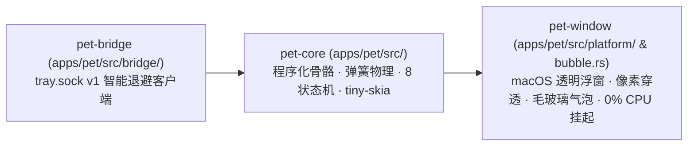

# MilkBird Desktop Pet (`apps/pet`)

奶鸟俱乐部（MilkBird Club）**性能优先的原生桌面伴侣** —— 纯 Rust + `tiny-skia` 矢量渲染 + macOS 原生 `NSPanel`/`CALayer` 透明置顶浮窗，**零 WebView / 零 Electron / 零 Live2D**。

## 1. 架构分层



- **`pet-core`**：纯 Rust 跨平台核心（`model` / `physics` / `state` / `scheduler` / `render`），无 GUI 依赖即可运行完整单元测试与 `@2x` PNG 导出。
- **`pet-window`**：零 WebView 的 macOS AppKit / QuartzCore 外壳（`NSPanel` + `CALayer.contents = CGImage` + `PingFang SC` 原生毛玻璃中文气泡 + 多屏吸附 + 休眠/锁屏/全屏 `0.0% CPU` 自动挂起）。
- **`pet-bridge`**：零侵入复用 `apps/tray/` 已发布的 `tray.sock` Unix Domain Socket v1 协议（`contracts/tray/v1/tools.md`），支持智能退避轮询、未读差分提醒、点击直达群聊（`open_room`）或唤起托盘主窗，以及无托盘时的安静离线伴侣降级。

## 2. 性能实测（Apple Silicon · macOS 26.0 · Release）

| 指标 | 设计预算 | 实机实测结果 |
| --- | --- | --- |
| Release 二进制体积 | `≤ 5 MB` | **`890 KB`** |
| 常驻内存（活动监视器 `Physical footprint`） | `≤ 25 MB` | **`12.6 – 14.3 MB`** |
| 待机（`Idle`）CPU 占用 | `≤ 1.0%` | **`~0.61% – 0.65%`** |
| 睡眠（`Sleep`）CPU 占用 | `≤ 0.2%` | **`~0.16% – 0.17%`** |
| 挂起 / 全屏 / 锁屏（`Suspended`）CPU 占用 | `0.0%` | **`0.00%`**（定时器完全注销） |
| 像素命中检测（`hit_test`） | `< 50 µs` | **`~4.3 ns`**（`O(1)` Alpha 查表） |

## 3. 快速构建与运行

在仓库根目录（`MilkBirdClient/`）执行：

```sh
# 1. 构建 Release 原生二进制
cargo build --release --locked --manifest-path apps/pet/Cargo.toml --bin milkbird-pet

# 2. 正常启动（自动连接 ~/.milkbird/tray.sock，未检测到托盘时自动进入离线伴侣模式）
./apps/pet/target/release/milkbird-pet

# 3. 一键单机演示模式（无需启动后端或托盘）
./apps/pet/target/release/milkbird-pet --demo

# 4. 自动轮播全部 8 种状态与 7 种表情
./apps/pet/target/release/milkbird-pet --demo tour

# 5. 指定行为模式或自定义 Mock Socket 联调
./apps/pet/target/release/milkbird-pet --mode stay --socket /tmp/mock-tray.sock
./apps/pet/target/release/milkbird-pet --offline
```

常用命令行参数：
- `--mode <free|stay|edge>`：设置初始行为模式（自由散步 / 原地乖坐 / 贴边挂机）。
- `--state <idle|walk|petted|alert|sleep|perch|suspended>`：以指定状态启动。
- `--demo [状态|tour]`：离线演示模式，`tour` 可顺序轮播全部状态与表情。
- `--socket <路径>`：覆盖默认 `${MILKBIRD_TRAY_DIR:-$HOME/.milkbird}/tray.sock` 路径。
- `--offline`：禁用托盘轮询，纯本地桌面伴侣运行。
- `--duration <秒>`：运行指定秒数后输出统计摘要并自动退出（便于自动化回归与性能采样）。

## 4. 交互与托盘联动说明

- **桌面交互**：左键单击摸头、头顶轻划抚摸、快速三连击触发转圈欢呼彩蛋、左键拖拽拎起并贴近屏幕左/右/底边吸附、右键打开原生菜单、顶部菜单栏 `奶鸟` 入口随时恢复隐身状态。
- **`tray.sock` v1 联调**：
  - 严格遵守 `contracts/tray/v1/tools.md`（32 KiB 帧上限、1 秒短超时、独立后台线程不阻塞渲染）。
  - 托盘在线活跃期 `4 s` 轮询轻量 `status`；待机/休眠自动退避至 `15 s`；锁屏/全屏/隐身挂起时暂停轮询（`0% CPU`）；托盘离线时以 `15 s → 22 s → 30 s` 退避探测并安静降级。
  - 当检测到 `unreadByRoom` 或 `unreadCount` 增长时，小奶鸟自动切入 `AlertMatch` 扑腾并弹出中文气泡；点击气泡优先调用 `open_room` 直达对应群聊并唤起 `MilkBird Tray` 主窗；已读归零后自动收起提醒。
- **配置持久化**：位置、行为模式与休眠状态保存在 `${MILKBIRD_TRAY_DIR:-$HOME/.milkbird}/pet-config.json`。

## 5. 测试与预览导出

```sh
# 静态检查（零警告门禁）
cargo clippy --manifest-path apps/pet/Cargo.toml --all-targets -- -D warnings

# 全量单元与 Mock Unix Socket 集成测试
cargo test --locked --manifest-path apps/pet/Cargo.toml

# 导出 8 状态 @2x 高清总览图与渲染基准
cargo run --release --locked --manifest-path apps/pet/Cargo.toml --bin milkbird-pet-preview -- /tmp/milkbird-preview
```
